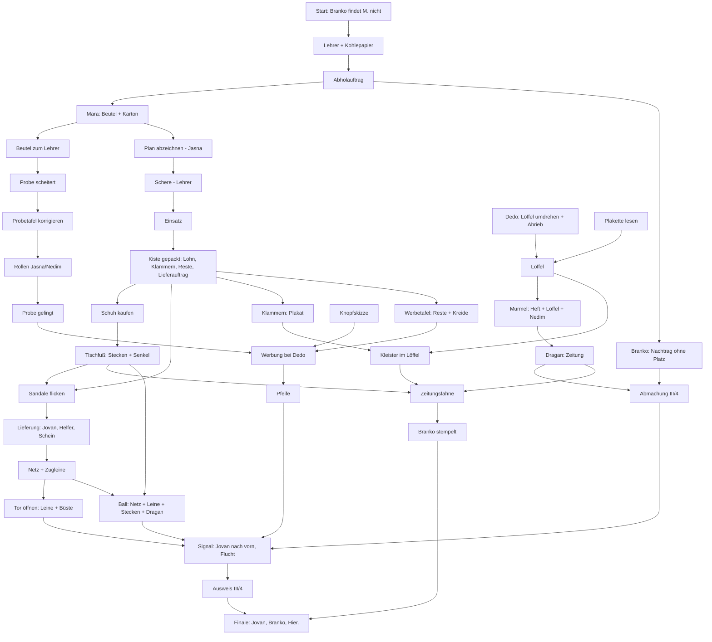

# C. Kapitelentwurf: Mostar 1955 – „Der Genosse kommt!“

Grundlage: PDF Abschnitt 8 (Figurenfassung, Drehbuch S01–S35, Wiederkehr- und Fehlversuchstexte). Die Dialogzeilen des PDF werden weitgehend wörtlich verwendet. Weil das PDF die V168-Rätsel nur andeutet und für den Neubau ausdrücklich freigibt, ist die **Rätselmechanik neu und vollständig ausgearbeitet**; Ergänzungen sind mit **[Eigen]** markiert. Zeitraum: 1955, ein warmer Nachmittag, FNR Jugoslawien; „Tiko“ ist die verfremdete Figur des PDF. **Bewusste fiktionale Verdichtung:** Schule, Markt, Stari Most und Paradestraße liegen näher beieinander als in der wirklichen Stadt; der Schulgründer (gest. 1898), seine Büste und Dedos Waren sind erfunden; Preise in Dinar sind Spielwerte, keine historischen Angaben.

---

## C1. Handlungsbogen

| Stufe | Umsetzung |
|---|---|
| **Einstieg / Ausgangslage** | Kurze Karte „Mostar, 1955“ **[Eigen]** („Ich war dreizehn und in Mostar noch neu. Im Klassenbuch stand ich ganz unten, nachgetragen, mit anderer Tinte.“), dann die weiterklickbaren Erzählzeilen S01 über dem Schulhof. Die Klasse wartet auf die Parade; Fähnchen werden ausgegeben. |
| **Persönliches Motiv** | M. will einfach bei seiner Klasse bleiben, winken und mit den anderen zurückgehen (S01). |
| **Zentraler Konflikt** | Branko, der Ordner, findet ihn nicht auf seiner Liste (S01): „Steht nicht hier.“ – „Ich stehe hier.“ – „Ich rede mit der Liste.“ |
| **Erste Nachforschungen, mehrere Ansätze** | Der Lehrer bestätigt: M. steht im Klassenbuch als Nachtrag; der Durchschlag für Branko ist falsch übertragen (S02). M. korrigiert ihn selbst (Kohlepapier) und bekommt einen Abholauftrag zum Markt (S03). Ab dort laufen mehrere Fäden parallel: Maras Kiste und Lohn, der Schulmaterialbeutel und die verunglückte Probe, Dedos „Frühstückslöffel des Schulgründers“, Nedims Murmel und Dragan an der Brücke. |
| **Zuspitzung (verändert die Bedeutung des Erreichten)** | **[Eigen, aus S03/S05 abgeleitet]** Branko liest den korrigierten Durchschlag: „Du stehst auf der Liste. Als Nachtrag.“ – „Und in der Aufstellung?“ – „Zwölf Plätze, zwölf Namen. Ein Nachtrag hat keinen Platz. Er steht unten.“ Das richtige Papier löst nichts. An der Sperre gilt zudem: Teilnehmer nur mit Ausweis und geprüftem Fähnchen. M. merkt: Den einzigen freien Platz hat Dragan, der lieber Fußball spielt (III/4). Aus dem Wunsch „dazugehören“ wird ein Plan, bei dem er unter fremdem Namen dasteht. |
| **Höhepunkt durch eigene Handlungen** | M. organisiert Dragans Flucht: Tor öffnen (Zugleine, Büste), Ball bergen (Netz, Leine, Dragan hält), Jovan mit dem richtigen Dienstsignal nach vorn schicken (Dedos Pfeife). Dragan entkommt und gibt ihm Ausweis III/4. Mit geprüfter Zeitungsfahne tritt M. in die Aufstellung. Brankos Aufruf: „Dragan?“ – Der Spieler wählt: „Hier.“ |
| **Auflösung des lokalen Konflikts** | M. wird als Dragan gezählt, sein eigener Name „fehlt“ (Brankos Welt ist vollständig). Die Parade, Dragans Ball auf der Route, Tikos „Braver Junge.“ – „Welcher?“ (S33/S34). Nach der Entlassung: „M.!“ – „Hier.“ – „Ich weiß. Bis morgen.“ (S35) |
| **Zurückhaltender Ausblick** | Abschlusstext S35, dann Abschlussbild mit der Reiselinie der Lebensstationen (nur Mostar abgeschlossen) und Rückkehr zum Hauptmenü (PDF-Vorgabe). Kein Übergang in die Gegenwart (gehört laut PDF zur Gesamtspielfassung). |

**M.s innere Bewegung:** anfangs „Erwachsene regeln das“ → er irrt: Zuständigkeit ist nicht Hilfe, und ein richtiges Papier ist kein Platz → schwere Entscheidung: „Hier.“ für einen anderen zu sagen und sich unter dem eigenen Namen abwesend melden zu lassen → am Ende persönliche Anerkennung statt behördlicher Identität.

---

## C2. Figuren

| Figur | Funktion | Eigenes Ziel | Widerspruch / Schwäche | Beziehung zu M. | Wissen / Irrtum | Hilft, lehnt ab, stellt Bedingungen | Veränderung im Kapitel |
|---|---|---|---|---|---|---|---|
| **M.** (13) | Spielfigur | bei der Klasse bleiben, gezählt werden | nimmt Behauptungen wörtlich, ist frech aus Unsicherheit | – | glaubt, Papiere und Erwachsene regeln es | – | vom Übersehenen zum Mitverschwörer; anerkannt ohne Liste |
| **Der Lehrer** | Autorität, Bestätiger | gelungener Auftritt seiner Klasse | gesteht Fehler ungern, schon gar nicht vor Branko | hält M. zunächst für ein Problem | weiß, dass M. im Klassenbuch steht; übersieht seinen eigenen Kopierfehler | bestätigt erst, als M. den Fehler selbst zeigt; leiht die Schere nur gegen Begründung | gesteht den Fehler (S03), lässt die Probe korrigieren, kennt M. am Ende ohne Liste (S35) |
| **Mara** (Marktfrau) | Arbeitgeberin, Prüferin | Ware heil abliefern, Arbeitsmittel zurück | streng mit Absprachen; keine Zeit für „kostenlose Hilfsbereitschaft“ | erst unbekannter Abholer, dann Vertrauter | prüft Unterschriften, nicht Gesichter | gibt nur gegen Auftrag; Lohn erst nach Prüfung; stoppt den unsicheren Transport (Sandale) | vertraut ihm eine Lieferung an, verteidigt seinen Lohn gegen Dedo, hält ihr Wort (Netz, Zugleine) |
| **Dedo Muratović** | Händler, Gegenspieler mit Charme | Geschäfte, Ruf als Kenner | Geschichten sind Teil seiner Ware; verliert ungern | Kunde, dann Rivale, dann Geschäftspartner | sein Löffel „des Schulgründers“ stammt von 1954 | hält seine Garantie trotzdem ein; Pfeife nur gegen bessere Werbung mit echtem Käufer | wird vorsichtiger, nicht bescheiden; erweitert „seine Methoden“ |
| **Branko** (Ordner) | Verkörperte Liste | eine korrekte Aufstellung | vertraut dem Verfahren mehr als seinen Augen | sieht M. nur als Eintrag | Nachtrag = kein Platz; Stempel = Wirklichkeit | prüft nur, was in der richtigen Ablage liegt | bleibt gleich – das ist die Pointe: er zählt M. als Dragan |
| **Dragan** (13) | Platzinhaber, Fluchtpartner | Fußball statt Parade | eigennützig, schneller mit Vorschlag als mit Dank | erst Tauschpartner, dann vertraut er ihm | weiß, dass sein Platz III/4 frei wird, wenn er geht | Tausch: Murmel gegen Zeitung; Platz und Ausweis erst, wenn er mit Ball draußen ist | sagt am Ende „Wir haben ihn.“ und „Danke“ |
| **Jasna** (13) | Ordnung in der Klasse | dass die Probe gelingt | ärgert sich über unklare Anweisungen, ist präzise bis frech | Mitschülerin, später Verbündete | weiß, wo Dragan stehen sollte (III/4) | lässt den Plan abzeichnen („Lass III/4 frei“), übernimmt das Vorlesen | „Das ist heute kein schlechtes Zeichen“ – sie folgt M.s Zeichen |
| **Nedim** (12) | Pechvogel | nicht ständig der Schuldige sein | verteidigt sich mit Wortklauberei, Angst vor Fehlern | Mitschüler | weiß genau, wo die Murmel liegt | hilft bei der Bank nur, wenn eine Auffangfläche bereitliegt | hält die Pause ein – „diesmal nicht an allem schuld“ |
| **Jovan** (Redar an der Sperre) | Schranke mit Gewissen | Dienst nach Vorschrift | Pflichten widersprechen sich (Passage bewachen vs. Signal befolgen) | Kontrolleur | kennt jedes Dienstsignal | lässt Lieferhelfer durch, Teilnehmer nur mit Ausweis und Fähnchen; befolgt jedes richtige Signal | geht nach vorn, obwohl er ahnt – „Dafür stehe ich hier.“ |
| **Plakatkleber** | Arbeiter mit Stolz | fertig werden, beim Fußball recht behalten | kann praktische Hilfe annehmen, ohne seine Behauptung zurückzunehmen | Helfer auf Gegenseitigkeit | glaubt nicht an Veležs 2:1 | Kleister nur, wenn das Plakat hält (und gegen einen Behälter) | prüft am Kiosk, gibt zu: „Die Zeitung stimmt.“ |
| **Veranstaltungshelfer** | Abnehmer der Lieferung | Flaschen zählen, weiter | freundlich, gedanklich schon woanders | Lieferant und Abnehmer | zählt in Vierergruppen | unterschreibt die Lieferung, „nicht die Absicht“ | merkt, „dass einer aufpasst“ |
| **Tiko** | kurzer Auftritt | – | – | – | – | – | bleibt Randfigur (PDF: keine Nebenhandlung, keine Rede) |

---

## C3. Orte und Szenenübersicht

Sieben Orte (sechs begehbar, eine Fensteransicht). Rückkehrbesuche bringen neue Reaktionen, weil Figuren auf Zustände reagieren (PDF Abschnitt IX).

| Ort | Erzählerische Funktion | Figuren | Hotspots | Rätselbeitrag | Zustandsänderungen | Ausgänge |
|---|---|---|---|---|---|---|
| **Schulhof** | Ausgangspunkt, Konflikt, Treffpunkt der Klasse | Branko, Jasna, Nedim, drei Mitschüler | Schulhaustür, Schultor, Brankos Tisch mit drei Ablagen und Stempel, Aufstellungsplan (3×4), Probetafel, Bank (Fuge mit Murmel), Feigenbaum, Klassenkameraden | Liste (Start), Raster abzeichnen, Probe, Murmel, Fahnenstempel | Tor offen nach Auftrag; Branko-Reaktion „Nachtrag ohne Platz“; Probe gescheitert/gelungen; Murmel draußen; Fahne geprüft | Klassenzimmer, Markt (erst mit Auftrag) |
| **Klassenzimmer** | Autorität, Beweise, Werkzeug | Lehrer | Listenmappe (Kohlepapier), Schere, Kreide, Tafel, Büste mit Plakette, Bild von Tiko, Landkarte, Fenster | Kohlepapier, Plakette (Löffelbeweis), Schere (Einsatz), Kreide (Werbetafel), Knopfskizze, Zugang zum Fenster | Lehrer bestätigt/leiht/ kommentiert; Büste am Fenster | Schulhof, Fenster |
| **Fenster zum Hinterhof** (Nahansicht) | Mechanik von Dragans Fluchtweg | – | Fensterflügel, Riegel mit Ring, Tor, Offenrast-Haken, Passage, Büste, Leine | Tor öffnen | Fenster offen; Riegel gehalten; Tor in Offenrast; Leine zurück | Klassenzimmer |
| **Markt** | Arbeit, Handel, Lohn | Mara, Dedo | Maras Stand (Kiste, Flaschen, Karton), Dedos Stand (Schuh, Löffel auf Samt, Pfeife, Knopfkiste, Garantie-Schild, Tisch mit kurzem Bein und Stecken), Kupferläden, Minarett | Kiste packen, Löffelgarantie, Schuhkauf, Tischfuß, Werbung, Lieferung (Start/Ende) | Lohn, Reste, Klammern; Löffel; Schuh unter dem Tisch; Tafel bei Dedo; Netz/Leine | Schulhof, Stari Most, Straßensperre |
| **Stari Most** | Dragans Welt, Weite über der Neretva | Dragan | Ball auf dem Gesims, Brüstung, Gesims, Neretva, Halebija-Turm, Brückenrippen | Murmeltausch, Abmachung, Ballbergung | Zeitung, Abmachung, Ball zurück; Dragan zieht zur Passage | Markt |
| **Straßensperre** | Ordnung und Durchlass | Jovan, Plakatkleber, später Dragan | Schlagbaum, Dienstvorschrift, Plakatwand mit Plakat, Kleistereimer, Kiosk, Passage | Plakat/Kleister, Lieferkontrolle, Signal & Flucht, Finale-Einlass | Plakat hängt; Lieferzugang; Jovan vorn; Dragan weg | Markt, Paradestraße (nur über Jovan) |
| **Paradestraße** | Ziel, Bühne des Finales | Helfer; im Finale Klasse, Branko, Lehrer, Jovan, Tiko | Getränketisch, Aufstellungsmarkierungen, Tribüne, Zuschauer | Entladen 3×4, Unterschrift; Finale | Schein unterschrieben, Kiste leer | Straßensperre |

---

## C4. Rätselketten

Drei größere, verbundene Ketten und ein Finale. Jede Kette wird von den anderen gebraucht.

### Kette A – Papiere und Plätze
#### A1 Liste und Kohlepapier (S01–S03)
- **Ziel / Hindernis:** auf Brankos Liste kommen; der Durchschlag zeigt M. nicht.
- **Erzählerischer Grund:** Der Lehrer hat gestern den Durchschlag gemacht und M. nachgetragen; das Kohlepapier war ein Rest und reichte nicht bis ganz unten (S03 „Ich habe es gestern eingelegt.“).
- **Hinweise:** Branko schickt zum Lehrer (Option C); der Lehrer zeigt das Klassenbuch (S02); Ansehen der Mappe: „Ganz unten, mit anderer Tinte: ich. Darunter ein Rest Kohlepapier und der Durchschlag.“
- **Lösung:** Mappe öffnen → Nahansicht: Original anheben → Kohlepapier nach unten schieben, bis es unter dem Nachtrag liegt → Original zurücklegen → mit dem Bleistift nachfahren.
- **Fehlversuche:** Nachfahren ohne Verschieben: „Ich fahre meinen Namen nach. Unten kommt nichts an. Das Kohlepapier liegt zu hoch.“; Blätter auseinanderreißen: Lehrer „Nicht auseinanderreißen.“; Kohlepapier ganz herausziehen: „Dann kommt gar nichts mehr an.“
- **Folgen:** Durchschlag korrigiert; S03; Gegenstand **Abholauftrag**; Schultor offen; Notiz „Markt“.
- **Sackgassenschutz:** jederzeit wiederholbar; nichts kann verloren gehen.

#### A2 Zuspitzung: Nachtrag ohne Platz **[Eigen]**
- Nach A1 bei Branko: Durchschlag gilt, aber „Zwölf Plätze, zwölf Namen.“ → Notiz „Einen Platz in der Aufstellung finden“. Jasna/Plan zeigen III/4 (Dragan fehlt).

#### A3 Fahne und Stempel (S23)
- **Ziel / Hindernis:** Teilnehmer brauchen ein geprüftes Fähnchen (Dienstvorschrift an der Sperre, Branko). Fähnchen gibt es nur für die Liste.
- **Grund:** Brankos Welt: geprüft ist nur, was in der richtigen Ablage liegt.
- **Hinweise:** Kinder halten Fähnchen; Branko: „Fähnchen gibt es nur für Namen mit Platz.“ **[Eigen]**; Vorschrift an der Sperre; drei beschriftete Ablagen auf Brankos Tisch (LISTEN, MATERIALPRÜFUNG, SONSTIGES).
- **Lösung:** Zeitung (Dragan) + Stecken (Dedos Tisch) + Kleister im Löffel (Plakatkleber) → Zeitungsfahne. Fahne (oder die Zeitung allein) in die Ablage MATERIALPRÜFUNG legen → Branko stempelt „GEPRÜFT“.
- **Fehlversuche:** Fahne Branko zeigen: S23 „Das ist eine Zeitung am Stock … Das Material gehört in die Prüfung.“; falsche Ablage: „Das ist keine Liste.“ / „Sonstiges wird nicht geprüft. Sonstiges ist sonstig.“ **[Eigen]**; Stecken + Zeitung ohne Kleister: „Ohne Kleister rutscht das Papier herunter.“; Stempel nehmen: Branko „Der Stempel bleibt beim Ordner.“
- **Folgen:** Gegenstand „Zeitungsfahne (geprüft)“; Löffel wieder leer. Sportseite bleibt lesbar (PDF: „Die Fahne hat nichts vergessen.“).
- **Sackgassenschutz:** Zeitung und Stecken werden nur hier verbraucht; Kleister nur hier.

### Kette B – Arbeit und Lohn (Mara und Dedo)
#### B1 Abholauftrag und Kiste (S04–S07)
- **Ziel / Hindernis:** Mara gibt Schulmaterial nur gegen unterschriebenen Auftrag; ihre zwölf Flaschen brauchen eine Verpackung, in der keine gegen die andere schlägt.
- **Grund:** Mara „hat keine Zeit dafür, dass andere ihre Hilfsbereitschaft als kostenlose Dienstleistung behandeln“; Scherben kosten sie Geld.
- **Hinweise:** Mara (Option C): „Jede Flasche braucht ihren Platz …“; Kiste ansehen: „drei Reihen zu vier“; Jasna: „Drei Reihen. Vier Plätze.“; Plan ansehen mit Karton in der Tasche: „Drei Reihen, vier Plätze. Wie Maras Kiste.“ **[Eigen]**
- **Lösung:** Auftrag zeigen → Beutel und Packkarton → Jasna fragen „Kann ich den Plan abzeichnen?“ → Karton auf den Plan → Raster abgezeichnet → beim Lehrer um die Schere bitten (S06: Stege, „Sonst passt die letzte Reihe nicht.“) → Einsatz → Einsatz in Maras Kiste.
- **Fehlversuche:** Karton auf Plan ohne Erlaubnis: Jasna „Finger weg, der Plan ist gerade richtig.“; Schere nehmen ohne Frage: „Die Schere gehört dem Lehrer.“; Einsatz ohne Raster: „Ohne Plan schneide ich nur kleinere Stücke Karton.“; Flaschen ohne Einsatz packen: Mara „Eine Kiste trennt keine Flaschen voneinander.“
- **Folgen:** S07; **Packlohn, Klammern, Kartonreste**; Lieferauftrag mit **Kiste** und **Lieferschein**.
- **Sackgassenschutz:** Karton erneut von Mara, falls er fehlt; Einsatz wird nur in der Kiste verbraucht.

#### B2 Löffel des Schulgründers (S08–S11)
- **Ziel:** Dedos Garantie einlösen. **Hindernis:** Dedo behauptet; Beweise fehlen.
- **Hinweise:** Garantie-Schild: „Stimmt eine Beschreibung nicht, gehört die Ware dem, der es beweist.“ **[Eigen, aus S11]**; Löffel umgedreht: „eingeprägt … flach wie auf einer abgegriffenen Münze“; Plakette an der Büste: Lebensdaten.
- **Lösung:** S09 „Darf ich ihn umdrehen?“ → Heft oder Bleistift am Löffel → **Abrieb** „1954“. Plakette lesen („gest. 1898“) bzw. Lehrer fragen (S10). Dedo mit beiden Belegen (S11) → **Löffel**.
- **Fehlversuche:** Löffel nehmen: „Die Schrift ja. Den Löffel nicht.“; nur ein Beleg: „Eine Jahreszahl allein widerlegt keine Geschichte.“
- **Folgen:** Löffel (Hebel, Kleisterbehälter); Lehrer-Kommentar in S19.

#### B3 Schuh und Tischfuß (S12–S13)
- **Ziel:** Dedos Stecken (für die Fahne). **Hindernis:** Er stützt Dedos kurzes Tischbein.
- **Hinweise:** Tisch ansehen: „kürzeres Bein, ein Stecken, Draht und Nagel“; Schuh ansehen: „Solider Absatz. Ungefähr so hoch wie der Spalt unter Dedos Tisch.“
- **Lösung:** Mit Packlohn den rechten Schuh kaufen (S12) → Schuh an Dedos Tisch (S13): Schuh unter das Bein, Senkel behält M. → Stecken nehmen.
- **Fehlversuche:** Schuh ohne Lohn: „Anprobieren kostet nichts. Wegtragen schon.“; Stecken vorher ziehen: „Stütze erst den Tisch. Ich stütze hier schon meinen Lebensunterhalt.“
- **Folgen:** **Stecken** (mit Draht und Nagel), **Schnürsenkel**.

#### B4 Lieferung (S24–S27)
- **Ziel:** Kiste zu den Helfern, Schein zurück. **Hindernisse:** Sandale reißt; Jovans Kontrolle; Unterschrift erst nach vollständiger Zählung.
- **Hinweise:** Mara stoppt den Transport (S24); Notiz Sandale; Jovan verlangt Schein (S25); Helfer zählt (S26).
- **Lösung:** Mit Kiste den Markt verlassen wollen → Sandale reißt (S24, Gegenstand „gerissene Sandale“) → Senkel + Sandale → Kiste wieder nehmen → Sperre: Jovan (S25) → Paradestraße: dreimal eine Vierergruppe abladen, dann „Hier unterschreiben“ (S26) → Mara: leere Kiste + Schein (S27) → **Netz** und **Zugleine**.
- **Fehlversuche:** zu früh unterschreiben lassen: „Ich unterschreibe die Lieferung, nicht die Absicht.“; Netz vorher verlangen: „Erst schließen wir die Lieferung ab.“; nur Kiste oder nur Schein: Mara nennt das Fehlende konkret.
- **Sackgassenschutz:** Sandale bricht nur einmal, Kiste bleibt bei Mara; Lieferzugang gilt bis zur Abgabe.

#### B5 Probe, Knopf, Werbung, Pfeife (S16–S21)
- **Ziel:** Dedos Pfeife (für Jovans Signal). **Hindernis:** Dedo braucht sie für seine Werbung; er tauscht nur gegen bessere: „ein Schild, ein passender Knopf, ein zahlender Kunde.“
- **Teilrätsel Probe:** Beutel zum Lehrer (S16) → Probe scheitert (S17: „Živio drugi Tiko!“ und „LAUT UND DEUTLICH!“) → mit der gedruckten Vorlage die Probetafel korrigieren (Wortlaut „drug“; Rahmen nur um die Rufzeile) → Rollen verteilen (S18: Jasna liest die Zeile im Rahmen, Nedim achtet auf die Pause) → Probe gelingt.
- **Teilrätsel Knopf:** Lehrer hält den Mantel zu (S19) → „Zeichne lieber den anderen ab“ → Heft/Bleistift am Lehrer → **Knopfskizze**.
- **Teilrätsel Schild:** Kartonreste + Kreide (Tafel im Klassenzimmer) → **Werbetafel** „MANTELKNÖPFE“.
- **Lösung:** Dedo: „Ich kann dir bessere Werbung machen.“ (S20) → mit Tafel, Skizze und gelungener Probe Jasna bitten mitzukommen (S21) → Kinder rufen, Lehrer kommt → den passenden Knopf aus Dedos Knopfkiste wählen (4 Löcher, dunkel, Größe der Skizze) → Lehrer zahlt → ausdrücklicher Tausch Tafel gegen **Pfeife**.
- **Fehlversuche:** Pfeife vor dem Verkauf: „Der Verkauf ist nur die Hälfte.“; falscher Knopf: „Zwei Löcher. Das ist ein Hemdknopf.“ **[Eigen]**; Probe ohne korrigierte Tafel: „Wir können es noch einmal genauso machen.“; ohne Rollen: Nedim redet in die Pause **[Eigen]**.

### Kette C – Dragans Flucht
#### C1 Murmel (S14) und Tausch (S15)
- **Ziel:** Dragans Vertrauen und seine Zeitung. **Hindernis:** Die Murmel steckt in der Fuge unter der Bank.
- **Hinweise:** Nedim „weiß genau, wo“; Bank ansehen: Fuge läuft schräg zum Ende aus; ohne Werkzeug: „Ich bräuchte etwas Schmales mit einem Hals.“ **[Eigen]**
- **Lösung:** Heft ans Bankende legen (Auffangfläche) → Nedim hält das Bankende (S14 Option A) → Löffel in die Fuge → Murmel rollt ins Heft. Murmel an Dragan → **Zeitung**; über den Platz sprechen → Abmachung (Platz III/4 + Ausweis, „wenn ich mit dem Ball draußen bin“).
- **Fehlversuche:** Bank ohne Auffangfläche: Nedim „Ich möchte sie nicht noch genauer verlieren.“; Löffel mit Kleister: „Der Hals ist frei. Der Kleister bleibt in der Mulde.“; Ausweis vorher: „Wir haben einen Tausch vereinbart, keine Anzahlung.“

#### C2 Tor (S28)
- **Ziel:** Hintertor für Dragans Weg öffnen. **Hindernis:** Riegel nur von innen erreichbar; fällt zurück, sobald man loslässt.
- **Hinweise:** Dragan: „Ich möchte hinaus, nicht auf halbem Weg den Riegel festhalten.“; Passage-Tor von außen ohne Griff; Fensterblick zeigt die Rückseite des Mechanismus; Büste „hält auch sonst Papier fest“.
- **Lösung:** Fenster öffnen → Zugleine am Riegelring einhängen und hochziehen → Büste auf die Leine schieben → Tor schwingt in die Offenrast → Leine zurücknehmen.
- **Fehlversuche:** ungesichert loslassen: „Der Mechanismus funktioniert leider auch ohne mich.“; Leine vor der Offenrast nehmen: „Die Zugleine hält noch den Riegel …“

#### C3 Ball (S29)
- **Ziel:** Dragans Ball vom Gesims. **Hindernis:** zu weit; er darf nicht in die Neretva fallen.
- **Lösung:** Netz + Zugleine → unter dem Gesims über die Brüstung hängen → Dragan hält die Leine (S29) → Stecken (oder Fahne) schubst den Ball ins Netz → hochziehen → Ball ausdrücklich übergeben.
- **Fehlversuche:** Ball ohne Netz bewegen: „Bewegen könnte ich ihn. Wiederfinden wäre schwieriger.“

#### C4 Signal und Flucht (S30–S31)
- **Ziel:** Jovan von der Passage weglocken. **Hindernis:** Er sieht genau hin.
- **Hinweise:** Dienstvorschrift („zwei kurze Pfiffe – Kontrolle am vorderen Schlagbaum“); S30; Dragans Zustandssatz nennt die fehlende Bedingung.
- **Lösung:** Wenn Ball übergeben, Tor offen, Abmachung steht und Dragan an der Passage wartet: Pfeife benutzen → „Zwei kurze Pfiffe“ → Jovan geht nach vorn → Flucht → **Ausweis III/4**.
- **Fehlversuche:** falsches Signal: „Übe leiser.“ (kein Verlust); richtiges Signal zu früh: M. pfeift nicht („Wenn Jovan jetzt nach vorn geht, braucht den Weg noch niemand.“) **[Eigen]**.

### Finale (S32–S35)
- Ausweis + geprüfte Fahne bei Jovan (S32) → Aufstellung → Branko (S33) mit Spielerwahl „Hier.“ / „Ich heiße M.“ (zurück zur Wahl) → Parade (S34) → Entlassung (S35) → Abschlusstext → Abschlussbild → Hauptmenü.

---

## C5. Abhängigkeitsplan

**Kritischer Pfad (längste Kette):** Branko → Kohlepapier → Auftrag → Karton → Raster → Schere → Einsatz → Kiste/Lohn → Schuh → Stecken/Senkel → Sandale → Lieferung → Netz/Leine → Tor + Ball → Signal (braucht Pfeife ← Werbung ← Probe, Skizze, Tafel) → Flucht → Ausweis → Finale (braucht auch die geprüfte Fahne ← Zeitung, Kleister, Stecken).

**Parallel offen** (nach dem Abholauftrag gleichzeitig verfolgbar, alle auf ein Ziel bezogen): Probe · Kiste · Löffel · Murmel/Dragan · Platzfrage. Später: Lieferung · Plakat · Fahne · Werbung · Tor · Ball.

---

## C6. Zuordnung der PDF-Szenen

| PDF | Umsetzung | Auslöser im Spiel |
|---|---|---|
| S01 Textintro + Auftaktdialog | Erzählzeilen über dem Schulhof, Branko mit Optionen A/B/C, Wiederkehrtext | Spielbeginn / Branko erneut |
| S02 Das Original hat keine Schuld | erstes Gespräch mit dem Lehrer, Optionen A/B/C | Lehrer vor der Korrektur |
| S03 Ein Fehler des Lehrers | nach der Kohlepapier-Nahansicht | Durchschlag korrigiert |
| S04 Mara liest bis zum Ende | Mara mit/ohne Auftrag, Optionen A/B/C | Mara |
| S05 Jasnas Ordnung | Jasna am Plan, Optionen A/B, Nach-Kopie | Jasna |
| S06 Unterricht außerhalb des Hefts | Lehrer mit Raster, Wiederkehr | Lehrer + Karton mit Raster |
| S07 Mara bezahlt | Packprüfung, Optionen A/B, Dedo-Kommentar | Einsatz in der Kiste |
| S08 Ein Stand ohne überflüssige Geschichten | Dedo-Themen | Dedo |
| S09 Der Löffel wird untersucht | Umdrehen, Abrieb | Dedo / Löffel |
| S10 Der Lehrer kennt den Schulgründer | Lehrer-Thema | nach Löffel-Thema |
| S11 Dedo hält sich an seine Garantie | beide Belege | Dedo |
| S12 Der Schuh wird bezahlt | Kauf mit Packlohn | Dedo + Lohn |
| S13 Dedo tauscht einen Tischfuß | Schuh an Tisch | Schuh an Tisch/Dedo |
| S14 Nedim weiß, wo die Murmel ist | Bank, Optionen A/B | Nedim |
| S15 Dragan zahlt mit Papier | Tausch, Platzgespräch, Abmachung | Dragan + Murmel |
| S16 Mara übergibt, der Lehrer packt aus | Beutel | Mara / Lehrer |
| S17 Der Unterricht hat sich versprochen | gescheiterte Probe | nach Beutel |
| S18 Jeder bekommt seine Aufgabe | Rollen, gelungene Probe | Jasna/Nedim, Lehrer |
| S19 Der fehlende Mantelknopf | Lehrer-Thema | Lehrer ansehen |
| S20 Dedo unterschätzt die Kundschaft | Werbehandel | Dedo |
| S21 Die Kinder werben, der Lehrer kauft | Werbeszene, Knopfwahl, Tausch | Jasna bitten |
| S22 Zwei Fachleute, eine freie Hand | Jovan/Plakatkleber-Streit, Klammern, Kiosk | Sperre |
| S23 Branko stempelt die Wirklichkeit | Ablage, Stempel | Brankos Tisch |
| S24 Mara sieht den Fuß | Sandale | Markt mit Kiste verlassen |
| S25 Jovan kontrolliert eine Kiste | Lieferzugang | Schlagbaum mit Kiste |
| S26 Drei Mal vier … | Entladen, Unterschrift | Helfer |
| S27 Mara hält ihr Wort | Netz, Zugleine | Mara + leere Kiste + Schein |
| S28 Die Büste beaufsichtigt den Hof | Fenstermechanik, Lehrerkommentar | Fensteransicht |
| S29 Dragan vertraut M. etwas an | Ballbergung | Brücke |
| S30 Jovans Signale sind eindeutig | Vorschrift/Jovan, Signalwahl | Sperre |
| S31 Vereinbart ist vereinbart | Zustandssätze, Flucht, Ausweis | Dragan / Signal |
| S32 Keine Kiste mehr | Einlass mit Ausweis | Schlagbaum |
| S33 Brankos vollständige Welt | Aufruf, Wahl | Finale |
| S34 Die Parade, endlich | Parade | Finale |
| S35 Nicht mehr nachsehen müssen | Entlassung, Abschlusstext | Finale |
| IX Wiederkehrende Gespräche | Lehrer/Mara/Dedo/Jovan/Plakatkleber/Jasna/Nedim je nach Zustand | Gespräche, Ortsbesuche |
| X Fehlversuche | als Rückmeldungen der jeweiligen Handlung | siehe C4 |

---

## C7. Spieldauer (Schätzung)
Ungetestet mit echten Spielern. Annahme aus Umfang (7 Orte, ca. 30 Gegenstände, 14 Teilrätsel, ca. 40 Gespräche): **etwa 1½ bis 2½ Stunden** beim ersten Durchspielen; mit Lösungsweg etwa 25–35 Minuten. Das PDF nennt 6–8 Stunden für das Gesamtspiel (acht Abschnitte).
